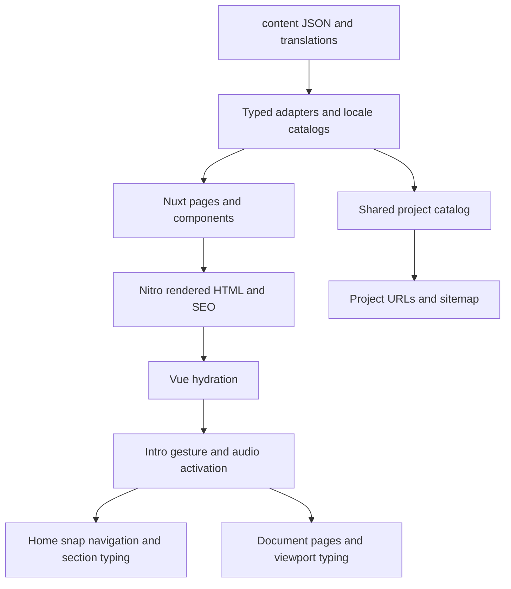

# Project review and working map

Reviewed on 2026-10-27 against commit `c4ef983` on `main`.
This is a baseline for future work, not a record of changes to application behavior.
The source, lockfile, existing documentation, tests and local production build were
inspected. Hosting dashboard settings and the deployed revision were not inspected.
Recheck relevant code when making changes; this document describes this revision.

## Architecture

This is an SSR Nuxt portfolio with substantial browser-side animation. Editable
content is bundled from JSON at build time. There is no database, authentication
system, CMS, application API, message delivery service, or external content fetch
in this repository. Nitro handles rendering, SEO headers, redirects, robots and
the sitemap. The contact form composes a local email draft and a `mailto:` link.
References to FastAPI, PostgreSQL, RAG and other technologies in portfolio records
describe showcased projects, not infrastructure used by this website.

| Layer | Implementation and responsibility |
| --- | --- |
| Application | Nuxt 4.4.8, Vue 3.5.40, Vue Router 5.2.0; resolved versions from `package-lock.json` |
| UI | Quasar 2.21.4 through `nuxt-quasar-ui` 3.0.1; buttons, layouts, tabs, menus, dialogs, cards and form controls |
| Languages | `@nuxtjs/i18n` 10.6.0, seven JSON catalogs and `usePortfolioI18n` |
| RTL | SSR `lang`/`dir`, Quasar language packs, `postcss-rtlcss` 6.0.0, Vazirmatn and explicit bidi isolation |
| Graphics | Three.js 0.186.1 for portrait/project scenes; raw WebGL for the shared Home background; SVG/CSS for other backgrounds |
| Scrolling | Custom Home panel navigation; Lenis 1.3.26 on desktop document pages, with native scrolling on coarse pointers/reduced motion |
| Sound | Native media element, Web Audio, gesture-based activation and shared composables |
| Styling | Plain CSS, extracted scoped styles, global popup styles and Quasar Sass variables; no Tailwind |
| Server/build | Nitro SSR, Vite, TypeScript 6.0.3 and `vue-tsc` 3.3.12 |
| Hosting configuration | Vercel hostname redirect in `vercel.json`; Nitro builds locally with the Node server preset |
| Assets | Committed WebP/JPEG/PNG/SVG, fonts, MP3s and generated English résumé PDF |

### Request and content flow

## Pages and component ownership

There are six page files: five main page types and one dynamic project route.
With six project records and seven languages, these yield 77 canonical URLs.
English is unprefixed; Spanish, German, French, Italian, Arabic and Persian use
`/es`, `/de`, `/fr`, `/it`, `/ar`, `/fa`. Language is determined by the URL.

| Route | Composition and behavior |
| --- | --- |
| `/` | `pages/index.vue` → `layouts/scroll.vue` → `ScrollContainer` → five `ScrollSection` instances: hero, about, projects, resume, cta |
| `/about` | `pages/about.vue` → identity/portrait, chapter navigation, Profile, Capabilities, principles, Toolkit and SelectedSystems |
| `/projects` | `pages/projects/index.vue` → `ProjectsArchive`; category filters, selection query, preview and screenshot dialog |
| `/projects/:slug` | Validates the catalog ID, returns 404 for unknown projects, reuses Archive with project metadata and expanded details |
| `/resume` | `pages/resume.vue`; shared profile/experience/project records, links and English PDF download |
| `/contact` | `pages/contact.vue`; enquiry intent, form validation, draft preparation, clipboard feedback and email-app link |

The default layout wraps document pages in Quasar layout/header/page components
and restores document overflow. The scroll layout gives Home a fixed viewport.
`app.vue` owns the entry decision, boot cover, global transition effect, skip link,
language/direction and no-JavaScript reading fallback. `NuxtPage` is keyed by path:
locale/page changes remount pages, while project-query changes keep them mounted.

### Component inventory (37 components)

| Group | Components | Responsibility |
| --- | --- | --- |
| Shared shell | `AppHeader`, `AppLanguageControl`, `AppMusicControl` | Navigation, Home progress, locale switching, music toggle and volume |
| Entry/transitions | `LoadingScreen`, `PageSignalGlitch` | Manual entry/audio gesture and page transition cover with recovery timer |
| Home scrolling | `ScrollContainer`, `ScrollSection` | Wheel/touch/keyboard arbitration, nested overflow, current panel, inactive-panel accessibility |
| Home sections | `HeroSection`, `AboutSection`, `ProjectsSection`, `ResumeSection`, `CtaSection` | Page-specific composition and typing sequences |
| Home details | `AboutInfoCard`, `AboutInfoCardMobile` | Responsive profile cards with exposed `play()` methods |
| About | `Background`, `Chapter`, `Profile`, `Capabilities`, `Toolkit`, `SelectedSystems` | Decorative scene, viewport chapter entry, experience/capabilities/tool tabs and catalog links |
| Projects | `Archive`, `Background`, `Preview`, `ScreenshotDialog` | Selection/filtering/SEO, Three.js scene, screenshot/cover presentation and fit/zoom viewer |
| Resume | `Background` | Decorative CSS/SVG career scene |
| Contact | `Background`, `Signal` | Decorative communications scene and signal panel |
| Common | `HackerReveal`, `PageGlitch` | Controlled reveal and visible-only recurring text glitches |
| Animation | `TypewriterText`, `TypedLine`, `SegmentedLine` | Grapheme typing, ordered line bindings, accented segments and accessible source text |
| Animation | `GlitchText`, `GlitchTextTimer`, `GlitchCard` | Hover/focus, recurring text and image glitch effects |
| Animation | `GlitchPortrait`, `SectionBackground` | Particle portrait and five shader scenes for Home |

Nuxt derives component auto-import names from directories, such as
`AnimationGlitchPortrait` and `HomeHeroSection`. Moving/renaming a component can
change its public template name.

## Shared behavior

| Files | Responsibility / constraints |
| --- | --- |
| `useScrollSections.ts` | Shared section registry, index, direction and transition lock; module-level client navigation state |
| `useSectionHash.ts` | About chapter tracking, hash/history preservation, initial anchor restoration and Lenis adapter |
| `useTypingSequence.ts` | Ordered lines, completion, delayed advancement and once-per-language/client-visit state |
| `useViewportEntry.ts`, `useViewportTyping.ts` | Reading-area observation, delayed entry, intro gate and reduced-motion completion |
| `useAnimationEnvironment.ts` | One visibility/motion listener pair per Vue app with reference-counted cleanup and isolated SSR state |
| `useGlitchText.ts`, `utils/animatedText.ts` | Scrambling and grapheme segmentation; preserves Arabic marks, Persian join controls and emoji |
| `useEntryAudio.ts`, `useTypeSound.ts`, `useMainMusic.ts` | Entry gesture ordering, one shared typing/music AudioContext, cached buffers, media gain and persisted music volume |
| `useSelectSound.ts` | Separate click-sound AudioContext used by the document-level button plugin |
| `utils/introSession.ts` | Session entry policy: fresh tab/reload shows intro; an entered visit can skip it on document navigation |
| `utils/screenshotViewport.ts` | Image fitting/zoom calculation |
| `plugins/lenis.client.ts` | Desktop smoothing, tab visibility, page-scroll resets and preserving scroll for project-query changes |
| `plugins/button-sound.client.ts` | Delegated pointer/keyboard click effects with disabled-control exclusions |
| `plugins/glitch-scrollbar.client.ts` | Temporary scrolling class and HMR listener cleanup |
| `plugins/quasar-language.ts` | Request-bound Quasar language packs; avoids global server language mutation |

The loading screen is a visual boot sequence, not an actual dependency-health or
asset-loading report. Entry waits for a user gesture. Music playback/unlock calls
must remain synchronous with that gesture, especially for mobile browsers.

## Content, localization and assets

`content/*.json` is the editable source. `app/assets/data/*.ts` adapts that source
for the application and maintenance scripts; it is not the primary copy-editing
location. `content/README.md` contains the current authoring workflow.

| Desired change | Primary files |
| --- | --- |
| Identity, professional role, contacts | `content/profile.json` |
| Project records, ordering, featured selection | `content/projects.json` |
| Résumé experience/skills/PDF settings | `content/resume.json` |
| Home headings, accents, timing | `content/home.json` |
| About shared content / full page | `content/about.json`, `content/about-page.json` |
| Contact intents and heading | `content/contact.json`; form behavior stays in `app/pages/contact.vue` |
| Page title/description sources | `content/seo.json` |
| Interface lookup labels | `content/interface.json`; visible overrides belong in translation files |
| Visitor-facing copy | `content/translations/en.json` and the six other locale files |
| Portrait paths | `content/images.json`; source PNGs in `assets/images/originals/` |
| Design, spacing, responsive rules | `app/assets/css/`, plus component-local styles |
| Shader appearance | `app/graphics/portraitShaders.ts`, `sectionBackgroundShaders.ts` |

`i18n/english.ts` flattens content into readable authoring keys. `defineLocale`
and `catalog` convert those into source-text hash lookups. `usePortfolioI18n().c`
translates interface strings; `content()` recursively translates records while
preserving structural keys such as IDs, links, image paths, category and license.
Repeated source text shares a translation. English editorial overrides also apply.
Changing source copy requires reviewing translations for meaning, even when keys
remain valid. Technical values intentionally use English fallback in some places.

Projects currently include Arilvo, DocIntel, Arvand Termo Tec, Raymand Group,
DocIntel Backend and ghssh. Four are featured on Home. IDs drive permanent URLs,
resume references, selected systems, translation keys and sitemap entries.
Renaming/removing a published ID needs an explicit URL/redirect decision.

`scripts/check-content.ts` validates project shape, assets, references and required
translations before `npm run build`. It does not comprehensively validate every
non-project JSON structure. Avoid assuming that all valid JSON is safe UI input.

Asset maintenance uses Sharp supplied separately to the image/icon scripts.
Generated images are committed; deployment does not require Sharp. Résumé
generation uses Node plus Python with ReportLab and pypdf and updates the committed
English PDF; editing JSON alone does not regenerate that download. The manifest
uses browser display; there is no service worker/offline implementation here.

## Infrastructure and SEO

`nuxt.config.ts` configures modules, CSS/RTL, runtime public values, asset redirects
and compressed public assets. `package-lock.json` supports reproducible installation.
No Docker, Terraform, GitHub Actions workflow, test CI, monitoring or analytics
integration is checked in. Vercel may still have project settings outside the repo.

`shared/seo.ts` fixes the canonical origin to `https://arsamsarkhosh.ir`.
`siteOrigin()` validates its input but returns that fixed production origin;
`NUXT_PUBLIC_SITE_URL` is therefore not a general domain-change switch.
`usePortfolioSeo.ts` owns localized page/social metadata, canonical/hreflang and
Person/WebSite/page/project/breadcrumb JSON-LD. Its serializer escapes script
terminators. `shared/projectRoutes.ts` derives detail paths from the catalog.

Server middleware normalizes trailing slashes on known pages and supplies the
noindex header when disabled. Server routes generate `robots.txt` and
`sitemap.xml`. Preview/noindex mode disallows crawling and disables the sitemap.
`vercel.json` redirects only the old public Vercel hostname to the canonical host.

`docs/seo.md` records an earlier apex-to-www dashboard redirect and a coordinated
release procedure. That observation is historical; this review does not establish
the current dashboard/DNS/deployment state. Inspect it before changing host policy.

## Findings and maintenance priorities

### 1. Review locked dependency advisories before the next release

`npm audit --omit=dev --json` on this date reported 23 affected package entries:
5 critical, 12 high, 5 moderate and 1 low. This is the dependency-tree report,
not 23 demonstrated exploitable paths in the deployed site. Nuxt is a production
dependency and brings build/dev tooling into this audit scope as well.

Nuxt 4.4.8, Vue/server-renderer 3.5.40 and Nuxt DevTools appear in the report.
The upstream [Nuxt route-rule advisory](https://github.com/nuxt/nuxt/security/advisories/GHSA-vjh5-4x84-xrqp)
includes the locked Nuxt range. The [Vue server-renderer advisory](https://github.com/vuejs/core/security/advisories/GHSA-g2v6-rqmx-r4w6)
concerns attacker-controlled attribute keys; this review did not identify that
input path in this portfolio. `devtools.enabled` is true in the Nuxt config;
dev-server exposure requires separate consideration from production SSR.
Triage runtime versus development reachability, update in a focused change and
rerun the existing checks. No dependency versions or lockfile were changed here.

### 2. Project filters fail if a category becomes empty

`app/components/projects/Archive.vue:70-75` dereferences
`visibleProjects.value[0]!.id` when changing to a category without the current
selection. All three categories have records today. Removing the last tool
project leaves a valid project catalog but the Developer tools button still
exists; selecting it then dereferences `undefined`. An in-memory catalog with
tools removed passed `validateProjectContent`, and the selection expression
reproduced the exception. Add an empty-state/selection guard or derive available
filters when implementing project removal.

### 3. Home portrait lacks an initialization fallback

`app/components/Animation/GlitchPortrait.vue:781-803` dynamically imports Three.js
and constructs `WebGLRenderer` without a catch/fallback. Its template contains
only a canvas. If import/context creation fails, the portrait can disappear and
the mounted hook rejects. The project background already guards context creation
and catches initialization failure. A static portrait fallback would make Home
equally resilient. This is a source-inspection finding, not an observed failure
in the working browser used here.

### 4. Performance work should target measured heavy assets

The local build warns about a 746.77 kB minified client chunk (191.66 kB gzip);
Three.js is dynamically imported by both graphics owners. Another client chunk
is 367.48 kB (132.35 kB gzip). The music file is 5,034,774 bytes out of roughly
6 MB under `public/`, and `AppMusicControl` preloads it on mount. Investigate
network timing and rendering cost on real phones before choosing changes.
These sizes are not Core Web Vitals measurements. Existing mobile sampling,
frame caps, offscreen/tab pausing, reduced-motion rules and GPU cleanup are useful
and should be preserved.

### 5. Keep contributor instructions and checks reproducible

The root README still directs copy edits to `app/assets/data/*.ts`; the newer
`content/README.md` correctly describes JSON authoring. Some older documentation
also quotes 70 routes and historical test totals. Prefer this review/current
checks for the inventory, and align those instructions in a documentation task.

`package.json` does not declare Node engines or a package manager, although the
maintenance workflow executes TypeScript directly in Node (the résumé script
documents Node 22.18+). There is no single `npm test` script or checked-in CI gate.
Some tests check source strings instead of exercising browser behavior, so passing
unit checks does not replace interaction/device checks for scrolling/audio/WebGL.

## Validation performed

The pre-existing `node_modules` lacked declared i18n/type-checking/RTL packages.
`npm ci` restored the locked install successfully. Only ignored dependencies and
generated build files were refreshed; tracked application source was unchanged.

| Check | Result |
| --- | --- |
| `npm run content:check` | Passed: 6 projects, 4 featured, 6 experiences, 7 locales |
| `npm run typecheck` | Passed |
| `npm run test:i18n` | 13 assertions passed |
| Each `tests/*.test.ts` executed directly with Node | 51 assertions passed across 8 files |
| `npm run build` | Passed; large-client-chunk and module-preload sourcemap warnings |
| `npm run test:seo:http -- http://127.0.0.1:3001` | Passed for all 77 localized production routes and asset/SEO checks |
| Same HTTP script with `--preview` on port 3002 | Passed for all 77 routes with noindex and a deliberately different runtime site URL |
| Browser smoke check | Entry, Home rendering, Projects navigation, Developer tools filtering, Persian switch retaining `?project=ghssh` |
| Browser console in those checked flows | No captured errors or warnings |
| `npm audit --omit=dev` | Findings recorded above; no automatic fix applied |

The `node --test` invocation in this environment reported eight file-level passes;
direct execution was also used to verify the actual 51 named assertions. Local
HTTP checks do not prove deployed behavior, search indexing, production security
reachability, real-user performance, native-speaker copy quality or iOS audio.

For future work, start with the feature owner in the tables above, follow its
content/localization/state dependencies, then rerun the relevant checks. Preserve
audio gesture ordering, inactive-section focus handling, query-selection scroll
position, SSR text, RTL shaping, and timer/observer/GPU cleanup.
